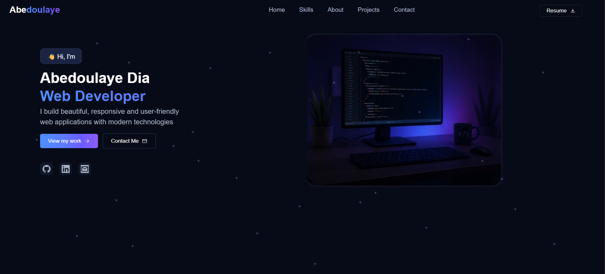

# Portfolio

My personal portfolio website built with React and TypeScript. Showcases my projects, skills, and experience as a front-end developer.



## 🚀 Live Demo

[View Live Demo](https://my-portfolio-beige-eta-85.vercel.app/)

## ✨ Features

- **Responsive Design** — Fully responsive across desktop, tablet, and mobile
- **Smooth Animations** — Particle background, marquee skills carousel, hover effects
- **Project Showcase** — Featured projects with live demo and GitHub links
- **Contact Section** — Email and social links for easy outreach
- **Dark Theme** — Clean, modern dark interface
- **Downloadable Resume** — One-click resume download

## 🛠️ Tech Stack

| Technology | Purpose                |
| ---------- | ---------------------- |
| React      | UI framework           |
| TypeScript | Type safety            |
| CSS        | Styling and animations |
| Vite       | Build tool             |
| Vercel     | Deployment             |

## 📦 Installation

1. **Clone the repository**
   ```
   git clone https://github.com/yourusername/portfolio.git
   cd portfolio
   ```
2. Install dependencies

```
npm install
```

3. Start the development server

```
npm run dev
```

4. Open http://localhost:5173 in your browser

## 📁 Project Structure

text
portfolio/
├── public/
│ └── resume.pdf
├── src/
│ ├── assets/
│ ├── components/
│ │ ├── Hero.tsx
│ │ ├── Skills.tsx
│ │ ├── About.tsx
│ │ └── Projects.tsx
│ ├── App.tsx
│ ├── App.css
│ └── main.tsx
├── index.html
├── package.json
└── README.md

## 📄 License

MIT
